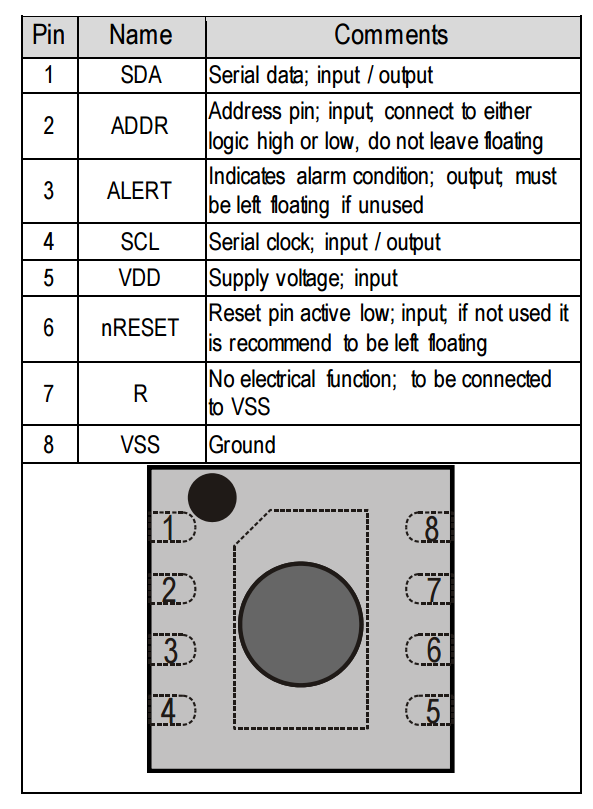
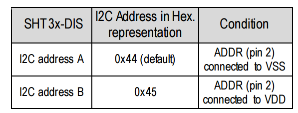
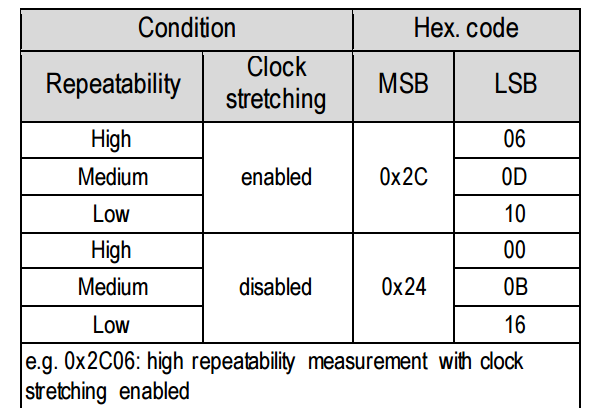
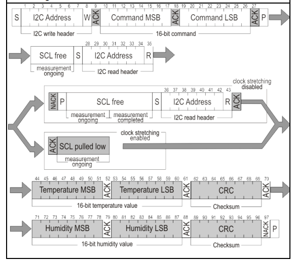
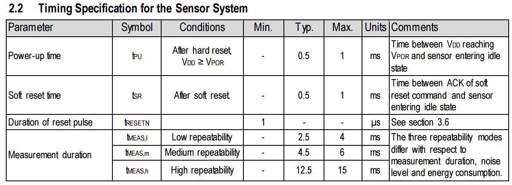
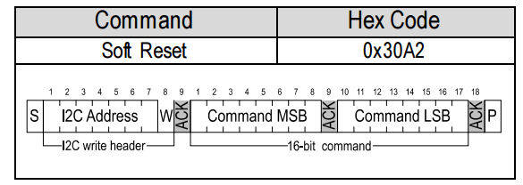
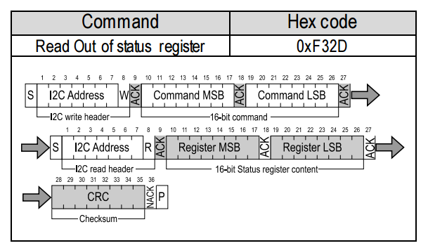
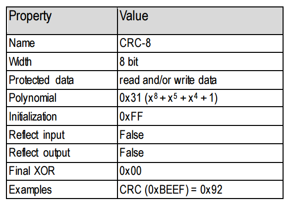
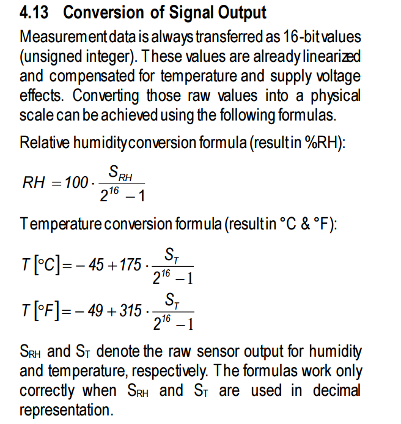

# SHT30

SHT30是一个温湿度计，使用I2C通信

## datasheet信息



SHT30的从机地址默认是`0x44`，可以通过ADDR pin接到VDD，也就是输入高电平来修改为`0x45`



我购买的sht30没有引出ADDR引脚，所以使用`0x44`

Chapter 4.3 介绍了单次测量的命令，返回的数据为16bit的温度和16bit的湿度，以及CRC校验码



其中clock stretching是I2C协议中的一种硬件流控机制。在标准 I2C 通信中，时钟线(SCL)完全由主机控制。但当从机（如 SHT30）收到测量命令后，内部ADC需要时间进行转换。如果此时主机立刻发起读取，从机还没准备好数据。

有了Clock Stretching，从机可以主动将SCL线拉低，强制暂停总线时钟。主机会检测到 SCL 被拉低并自动进入等待状态，直到从机完成转换、释放SCL线后，通信才会继续。

实际工程中不推荐使用，因为（1）I2C控制器可能不兼容（2）总线阻塞风险（3）超时不可控（4）波形调试困难



sht30各种操作需要的时间



Chapter 4.9 介绍了软复位的命令，我们需要在`probe`函数中对其软复位，排除未知状态的影响



Chapter 4.11 介绍了读取sht30状态的命令



Chapter 4.12 介绍了sht30的CRC校验格式。读取数据后需要计算CRC来确保数据可靠



Chapter 4.13 介绍了温湿度数据的转换计算方法



## I2C子系统

## IIO子系统

IIO (Industrial I/O) 是Linux内核中专门为数据采集类设备设计的标准框架。它位于`/sys/bus/iio/`下，提供了一套统一的接口来访问ADC、DAC、温湿度传感器、加速度计、陀螺仪等设备。

对于sht30，使用IIO子系统比起misc更加规范

## 调试

- 加载报错符号不存在，内核日志看是IIO的接口，以下定位到是存在这个包，但是没有加载到内核。补充加载就好了

```bash
cai@raspicai:~/share/misc-c/driver/sht30 $ sudo cat /proc/kallsyms | grep devm_iio_device_alloc
cai@raspicai:~/share/misc-c/driver/sht30 $
cai@raspicai:~/share/misc-c/driver/sht30 $
cai@raspicai:~/share/misc-c/driver/sht30 $ ls /lib/modules/$(uname -r)/kernel/drivers/iio/industrialio.ko* 2>/dev/null
/lib/modules/6.18.34+rpt-rpi-2712/kernel/drivers/iio/industrialio.ko.xz
cai@raspicai:~/share/misc-c/driver/sht30 $
cai@raspicai:~/share/misc-c/driver/sht30 $
cai@raspicai:~/share/misc-c/driver/sht30 $ sudo modprobe industrialio
cai@raspicai:~/share/misc-c/driver/sht30 $
cai@raspicai:~/share/misc-c/driver/sht30 $ sudo cat /proc/kallsyms | grep devm_iio_device_alloc
ffffd06faafc6933 r __kstrtab_devm_iio_device_alloc      [industrialio]
ffffd06faafc6949 r __kstrtabns_devm_iio_device_alloc    [industrialio]
ffffd06faafc418c r __ksymtab_devm_iio_device_alloc      [industrialio]
ffffd06faafc44a4 r __crc_devm_iio_device_alloc  [industrialio]
ffffd06faaf821d0 t devm_iio_device_alloc        [industrialio]
```

验证设备树overlay是否成功

```bash
cai@raspicai:~/share/misc-c $ ls /sys/bus/i2c/devices/
1-0044  i2c-1  i2c-13  i2c-14
cai@raspicai:~/share/misc-c $ 
cai@raspicai:~/share/misc-c $ cat /sys/bus/i2c/devices/1-0044/
modalias              name                  of_node/              power/                subsystem/            uevent                waiting_for_supplier
cai@raspicai:~/share/misc-c $ cat /sys/bus/i2c/devices/1-0044/modalias 
of:Nsht30T(null)Cmiscc,sht30
```