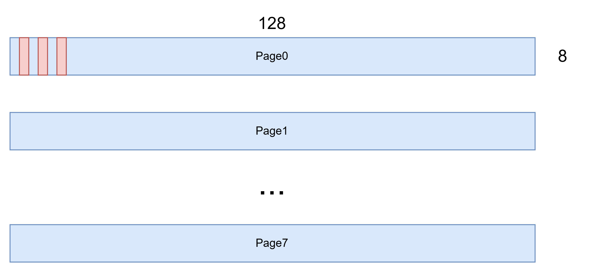

# SSD1306

购置了一个0.96寸OLED屏幕，使用的芯片是SSD1306，可以使用I2C或者SPI通讯。项目练习SPI协议通信

## SPI

SPI协议是全双工协议，需要四条通信线路：

- CS：片选线，表示选中设备进行通信，低电平有效
- SCL：时钟线
- MOSI：主机往从机发送数据
- MISO：主机从从机接收数据

通信过程：

```
CS   ‾‾‾\_______________________________________________/‾‾‾    ← 拉低=开始, 拉高=结束
SCK  ‾‾‾‾\_/‾\_/‾\_/‾\_/‾\_/‾\_/‾\_/‾\_/‾\_/‾\_/‾‾‾‾‾    ← 8个时钟脉冲 = 1字节
MOSI ----<D7><D6><D5><D4><D3><D2><D1><D0>-----------      ← 每个边沿传1bit
MISO ----<d7><d6><d5><d4><d3><d2><d1><d0>-----------      ← 同时在另一个方向传1bit
         ↑                              ↑
       开始                           结束
```

SPI还区分工作模式，由CPOL和SPHA两位来决定数据采样的位置

- CPOL：clock polarity，表示SCL空闲时的电平高低，0=低，1=高
- CPHA：在第几个边沿采样数据，0=第一个，1=第二个

组合为四种工作模式：

|MODE|CPOL|CPHA|空闲电平|采样边沿|
|---|---|---|---|---|
|Mode 0|0|0|低|上升沿|
|Mode 1|0|1|低|下降沿|
|Mode 2|1|0|高|下降沿|
|Mode 3|1|1|高|上升沿|

实践中需要根据芯片要求配置正确的工作模式

## OLED器件说明

模块默认使用的是标准4线SPI接口，也就是包含SCL，MOSI，MISO，CS，不过屏幕不需要发出数据，所以没有提供MISO

模块额外添加了两个引脚

- DC：用来区分发送的是命令还是数据
- RES：硬件复位信号，低电平有效

总结来说引脚使用如下：

|引脚丝印名|用途|
|---|---|
|GND|接地|
|VCC|电源，3.3V|
|D0|SPI SCL线|
|D1|SPI MOSI线|
|RES|复位，低电平有效|
|DC|数据命令区分，1=Data，0=CMD|
|CS|片选线，低电平有效|

树莓派5B对应引脚使用分配

|Pin编号|Method|分配|
|---|---|---|
|Pin 13|GPIO27|ssd1306 res|
|Pin 15|GPIO22|ssd1306 dc|
|Pin 19|GPIO10|ssd1306 mosi|
|Pin 23|GPIO11 / SPI0 SCLK|ssd1306 scl|
|Pin 24|GPIO8 / SPI0 CE0|ssd1306 cs|

ssd1306使用的工作模式是Mode 0

ssd1306的屏幕为长宽64*128的尺寸，划分为8个page，布局如下



对应bit写1就是点亮，按照1B写入，写入的是page中的一列

## 设备树编写

检验是否overlay成功，如下：

```bash
cai@raspicai:~ $ cat /sys/bus/spi/devices/spi0.0/of_node/compatible
miscc,ssd1306
cai@raspicai:~ $
```

## 驱动

## 调试

加载驱动卡死，检查发现有个内核自带驱动给匹配了

```bash
cai@raspicai:~ $ cat /sys/bus/spi/devices/spi0.0/uevent
DRIVER=ssd130x-spi
OF_NAME=ssd1306
OF_FULLNAME=/axi/pcie@1000120000/rp1/spi@50000/ssd1306@0
OF_COMPATIBLE_0=miscc,ssd1306
OF_COMPATIBLE_N=1
MODALIAS=spi:ssd1306
```

`DRIVER=ssd130x-spi`显示被这个驱动匹配，这是由于内核启动时解析设备树，寻找compatible属性一致的驱动，此时自定义驱动没有加载到内核，compatible回退匹配到了`ssd130x-spi`。后面再加载驱动就会引发SPI总线抢占死锁

解决办法之一是将其加入黑名单，禁止匹配。或者配置自定义驱动启动自动加载

```bash
cai@raspicai:~/share/misc-c $ echo "blacklist ssd130x-spi" | sudo tee /etc/modprobe.d/blacklist-ssd130x.conf
```

这下就好了

```bash
cai@raspicai:~ $ cat /sys/bus/spi/devices/spi0.0/uevent
OF_NAME=ssd1306
OF_FULLNAME=/axi/pcie@1000120000/rp1/spi@50000/ssd1306@0
OF_COMPATIBLE_0=miscc,ssd1306
OF_COMPATIBLE_N=1
MODALIAS=spi:ssd1306
cai@raspicai:~ $
cai@raspicai:~ $
cai@raspicai:~ $

cai@raspicai:~ $ sudo insmod /home/cai/share/misc-c/driver/ssd1306/miscc_ssd1306.ko
[sudo] password for cai:

cai@raspicai:~ $ dmesg | tail
[    4.917094] Bluetooth: RFCOMM socket layer initialized
[    4.917110] Bluetooth: RFCOMM ver 1.11
[    7.195941] macb 1f00100000.ethernet eth0: PHY [1f00100000.ethernet-ffffffff:01] driver [Broadcom BCM54213PE] (irq=POLL)
[    7.196819] macb 1f00100000.ethernet eth0: configuring for phy/rgmii-id link mode
[    7.199857] macb 1f00100000.ethernet: gem-ptp-timer ptp clock registered.
[    7.207348] brcmfmac: brcmf_cfg80211_set_power_mgmt: power save enabled
[   11.294361] macb 1f00100000.ethernet eth0: Link is Up - 1Gbps/Full - flow control off
[   77.521824] miscc_ssd1306: loading out-of-tree module taints kernel.
[   77.522037] SPI driver miscc_ssd1306 has no spi_device_id for miscc,ssd1306
[   77.522073] ssd1306 probe.

cai@raspicai:~ $ cat /sys/bus/spi/devices/spi0.0/uevent
DRIVER=miscc_ssd1306
OF_NAME=ssd1306
OF_FULLNAME=/axi/pcie@1000120000/rp1/spi@50000/ssd1306@0
OF_COMPATIBLE_0=miscc,ssd1306
OF_COMPATIBLE_N=1
MODALIAS=spi:ssd1306
```