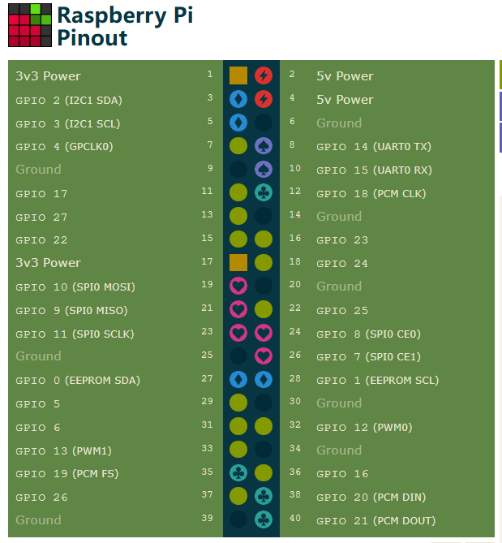

# Driver

本目录做一些驱动的学习，弥补工作技能的缺失

目录

- [led](miscc_led.md)

## GPIO信息

```bash
cai@raspicai:~/share/misc-c $ gpioinfo 
gpiochip0 - 54 lines:
        line   0:       "ID_SDA"                input
        line   1:       "ID_SCL"                input
        line   2:       "GPIO2"                 input
        line   3:       "GPIO3"                 input
        line   4:       "GPIO4"                 input
        line   5:       "GPIO5"                 input
        line   6:       "GPIO6"                 input
        line   7:       "GPIO7"                 input
        line   8:       "GPIO8"                 input
        line   9:       "GPIO9"                 input
        line  10:       "GPIO10"                input
        line  11:       "GPIO11"                input
        line  12:       "GPIO12"                input
        line  13:       "GPIO13"                input
        line  14:       "GPIO14"                input
        line  15:       "GPIO15"                input
        line  16:       "GPIO16"                input
        line  17:       "GPIO17"                input
        line  18:       "GPIO18"                input
        line  19:       "GPIO19"                input
        line  20:       "GPIO20"                input
        line  21:       "GPIO21"                input
        line  22:       "GPIO22"                input
        line  23:       "GPIO23"                input
        line  24:       "GPIO24"                input
        line  25:       "GPIO25"                input
        line  26:       "GPIO26"                input
        line  27:       "GPIO27"                input
        line  28:       "PCIE_RP1_WAKE"         input
        line  29:       "FAN_TACH"              input
        line  30:       "HOST_SDA"              input
        line  31:       "HOST_SCL"              input
        line  32:       "ETH_RST_N"             output active-low consumer="phy-reset"
        line  33:       "-"                     input
        line  34:       "CD0_IO0_MICCLK"        output consumer="cam0_reg"
        line  35:       "CD0_IO0_MICDAT0"       input
        line  36:       "RP1_PCIE_CLKREQ_N"     input
        line  37:       "-"                     input
        line  38:       "CD0_SDA"               input
        line  39:       "CD0_SCL"               input
        line  40:       "CD1_SDA"               input
        line  41:       "CD1_SCL"               input
        line  42:       "USB_VBUS_EN"           output
        line  43:       "USB_OC_N"              input
        line  44:       "RP1_STAT_LED"          output active-low consumer="PWR"
        line  45:       "FAN_PWM"               output
        line  46:       "CD1_IO0_MICCLK"        output consumer="cam1_reg"
        line  47:       "2712_WAKE"             input
        line  48:       "CD1_IO1_MICDAT1"       input
        line  49:       "EN_MAX_USB_CUR"        output
        line  50:       "-"                     input
        line  51:       "-"                     input
        line  52:       "-"                     input
        line  53:       "-"                     input
gpiochip10 - 32 lines:
        line   0:       "-"                     input
        line   1:       "2712_BOOT_CS_N"        output active-low consumer="spi10 CS0"
        line   2:       "2712_BOOT_MISO"        input
        line   3:       "2712_BOOT_MOSI"        input
        line   4:       "2712_BOOT_SCLK"        input
        line   5:       "-"                     input
        line   6:       "-"                     input
        line   7:       "-"                     input
        line   8:       "-"                     input
        line   9:       "-"                     input
        line  10:       "-"                     input
        line  11:       "-"                     input
        line  12:       "-"                     input
        line  13:       "-"                     input
        line  14:       "PCIE_SDA"              input
        line  15:       "PCIE_SCL"              input
        line  16:       "-"                     input
        line  17:       "-"                     input
        line  18:       "-"                     input
        line  19:       "-"                     input
        line  20:       "PWR_GPIO"              input active-low consumer="pwr_button"
        line  21:       "2712_G21_FS"           input
        line  22:       "-"                     input
        line  23:       "-"                     input
        line  24:       "BT_RTS"                input
        line  25:       "BT_CTS"                input
        line  26:       "BT_TXD"                input
        line  27:       "BT_RXD"                input
        line  28:       "WL_ON"                 output consumer="wl-on-reg"
        line  29:       "BT_ON"                 output consumer="shutdown"
        line  30:       "WIFI_SDIO_CLK"         input
        line  31:       "WIFI_SDIO_CMD"         input
gpiochip11 - 15 lines:
        line   0:       "RP1_SDA"               input
        line   1:       "RP1_SCL"               input
        line   2:       "RP1_RUN"               output consumer="RP1 RUN pin"
        line   3:       "SD_IOVDD_SEL"          output consumer="vdd-sd-io"
        line   4:       "SD_PWR_ON"             output consumer="sd-vcc-reg"
        line   5:       "SD_CDET_N"             input active-low consumer="cd"
        line   6:       "SD_FLG_N"              input
        line   7:       "-"                     input
        line   8:       "2712_WAKE"             input
        line   9:       "2712_STAT_LED"         output active-low consumer="ACT"
        line  10:       "-"                     input
        line  11:       "-"                     input
        line  12:       "PMIC_INT"              input
        line  13:       "UART_TX_FS"            input
        line  14:       "UART_RX_FS"            input
gpiochip12 - 6 lines:
        line   0:       "HDMI0_SCL"             input
        line   1:       "HDMI0_SDA"             input
        line   2:       "HDMI1_SCL"             input
        line   3:       "HDMI1_SDA"             input
        line   4:       "PMIC_SCL"              input
        line   5:       "PMIC_SDA"              input
gpiochip13 - 4 lines:
        line   0:       "WIFI_SDIO_D0"          input
        line   1:       "WIFI_SDIO_D1"          input
        line   2:       "WIFI_SDIO_D2"          input
        line   3:       "WIFI_SDIO_D3"          input
```

加载驱动，验证

```bash
cai@raspicai:~/share/misc-c/driver/led $ 
cai@raspicai:~/share/misc-c/driver/led $ dmesg | grep -i "LED probed"
[ 1370.427264] gpio-led my-led-device: LED probed (/dev/my_led), default-state=off
cai@raspicai:~/share/misc-c/driver/led $ 
cai@raspicai:~/share/misc-c/driver/led $ 
cai@raspicai:~/share/misc-c/driver/led $ ls -l /dev/my_led 
crw------- 1 root root 10, 264 Jul 30 09:52 /dev/my_led
cai@raspicai:~/share/misc-c/driver/led $ 
cai@raspicai:~/share/misc-c/driver/led $ 
cai@raspicai:~/share/misc-c/driver/led $ 
cai@raspicai:~/share/misc-c/driver/led $ 
cai@raspicai:~/share/misc-c/driver/led $ readlink /sys/devices/platform/my-led-device/driver
../../../bus/platform/drivers/gpio-led
```

## Pi5B引脚图



项目对引脚的分配进行规划如下：

Pin 11  : GPIO17        给 led

Pin 3   : SDA1          给 sht30 sda
Pin 5   : SCL1          给 sht30 scl
